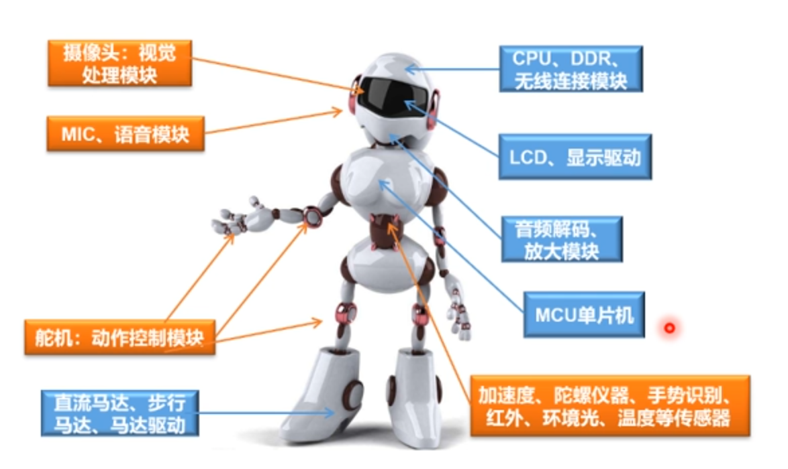
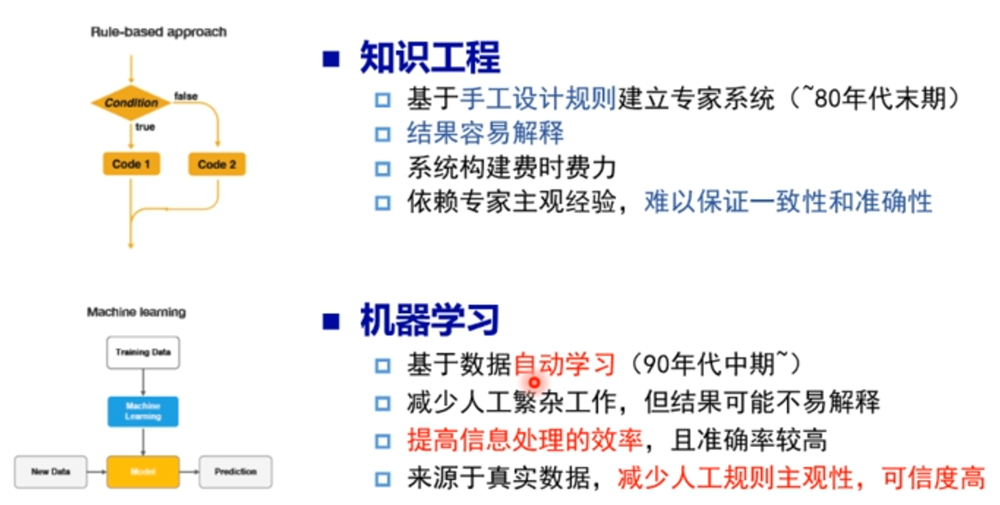
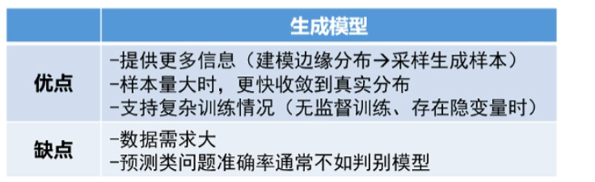

## 什么是人工智能？

**人工智能**：使一部机器像人一样进行感知、认知、决策、执行的人工程序或系统。

- **计算智能**：能存储、会计算
- **感知智能**：能听会说、能看会认
- **认知智能**：逻辑推理、决策思考

人工智能的分类体系：**人工智能 { 机器学习【是否应用了神经网络？no → 传统机器学习；yes → 深度学习（也叫神经网络）】}**

**后深度学习** —— 几分钟收集、标注，机器绞尽脑汁。

## 机器学习：从数据中提取知识

三要素：**模型（建模、确定假设空间）— 策略 — 算法**

### 模型

**01. 数据标记分类**

1. **无监督学习**：描述数据、发现信息
2. **监督学习**：预测数据标记、学习输入输出映射
3. **半监督学习**：（1）（2）混合，目的：控制成本
4. **强化学习**：知道与输出和目标相关的反馈、解决决策类问题

**02. 数据分布分类**

- 参数模型
- 非参数模型

**03. 建模对象分类**

- 生成模型
- 判别模型

